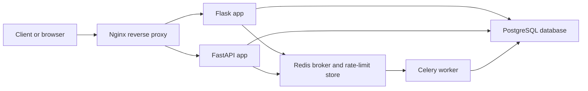
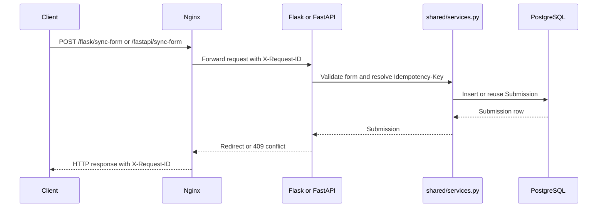
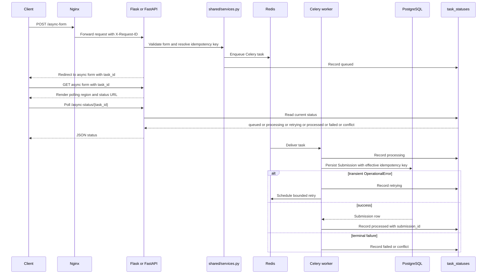
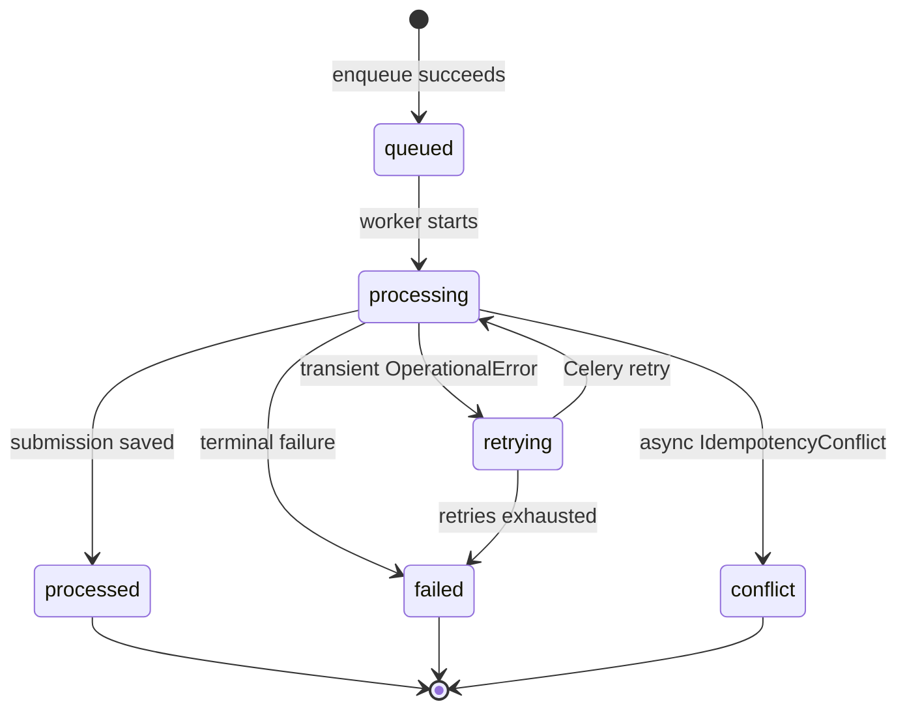

# Architecture

The same form-submission workflow is implemented in Flask and FastAPI. Shared modules handle validation, persistence, idempotency, request correlation, and task status; Celery processes queued submissions.

## System Topology

Runtime routing:
- `/flask/...` goes to the Flask service.
- `/fastapi/...` goes to the FastAPI service.
- The worker consumes async messages from Redis and writes to PostgreSQL.

## Dual-Framework Parity

The project intentionally keeps Flask and FastAPI side by side. That makes the shared reliability work easier to evaluate because both frameworks use the same validation, persistence, idempotency, task-status, and database layers while still exercising different HTTP stacks.

The parity goal is not to duplicate business logic. The framework routes stay thin; the shared modules carry the behavior that must remain consistent.

## Sync Flow

Sync idempotency is handled in the service layer. A safe key with the same payload reuses the existing row; the same key with a different payload becomes a conflict.

## Async Flow

The browser polling is deliberately simple: after enqueue, the async form polls every two seconds and stops on terminal states.

## Async Task State Machine

## Data Model Overview

### `submissions`

`submissions` stores successful sync and async form submissions. It includes:
- name and email fields from the form
- `form_type`
- `status`
- nullable unique `idempotency_key`
- `created_at`

The `idempotency_key` is nullable so old/keyless sync behavior can still insert multiple rows. Non-null keys are unique so replayed requests converge on one stored submission.

### `task_statuses`

`task_statuses` stores async task lifecycle by Celery `task_id`. It includes:
- `task_id`
- `status`
- optional `submission_id`
- optional `error_type`
- `retries`
- `created_at`
- `updated_at`

There is intentionally no foreign key. Failed or conflicted async tasks may never create a submission, and the status row still needs to exist.

## Why A Separate Task Status Table

Task status does not live on `Submission.status` because an async `Submission` row only exists after the worker succeeds. A failure, conflict, or worker-loss scenario can happen before there is any submission row to update.

Task status also does not use the Celery result backend. The worker keeps `task_ignore_result=True` so application visibility is owned by the domain database, not by broker/result-backend retention behavior. The `task_statuses` table gives the app a durable, queryable status surface while keeping Celery result semantics unchanged.
